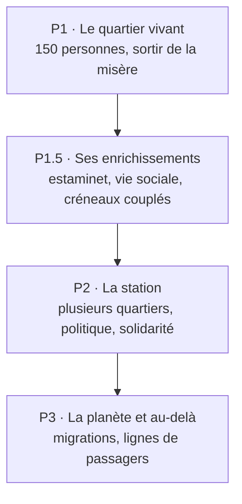
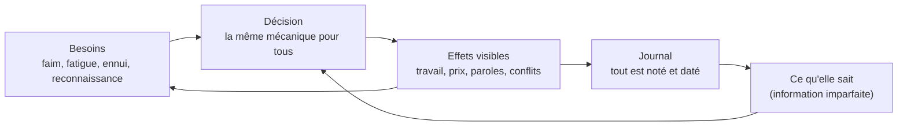

# Vestige : Horizon — le jeu expliqué à tout le monde

*Document d'accueil pour les personnes extérieures au projet. Aucun jargon sans explication. Dernière mise à jour : v7.7 du cadrage, novembre 2026.*

---

## 1. Le jeu en une phrase

Vous incarnez une personne pauvre d'un quartier miséreux d'une planète coloniale, et vous avez **300 ans de jeu** (plusieurs générations, par héritage) pour construire quelque chose qui vous dépasse : une entreprise, une famille influente, une institution, une colonie prospère.

C'est un jeu de **4X** : un jeu de stratégie où l'on **e**xplore, **e**xploite, **e**xpand et **e**xtermine — le terme vient des classiques du genre (Civilisation). Sauf qu'ici, la conquête n'est pas le cœur : le cœur, c'est **une société simulée pour de vrai**, où chaque personne du jeu a des besoins, un caractère, une mémoire et des raisons à elle.

---

## 2. Ce qui rend ce jeu différent

### 2.1 Les gens ne sont pas des décorations

Dans la plupart des jeux, les habitants d'une ville sont des figurines : ils marchent, ils disent trois phrases. Ici, chaque personne importante du jeu est un **individu simulé** : elle a faim, elle se fatigue, elle s'ennuie, elle a des souvenirs, des dettes, des amis, des griefs. Elle prend ses décisions avec la même logique que vous, le joueur. C'est la règle d'or du projet :

> **Le joueur n'a aucun pouvoir que les autres personnages n'ont pas.**

Si vous pouvez mentir, voler, monter une entreprise ou soudoyer un témoin, un habitant quelconque peut le faire aussi, avec les mêmes risques.

### 2.2 Tout a une cause, et la cause est consultable

Quand un restaurant ferme, quand une grève éclate, quand votre employé démissionne, la raison est **écrite quelque part** : le jeu tient un **journal** (une sorte de journal de bord interne) qui enregistre chaque événement et pourquoi il s'est produit. Rien n'arrive « au hasard pour faire vivant ». Si un quartier semble triste, c'est qu'il y a de vraies raisons de tristesse.

### 2.3 Le temps est long, donc les conséquences comptent

300 ans de jeu, ça veut dire : vos erreurs rattrapent vos héritiers, une dette d'entretien négligée devient une ruine, une école bien tenue produit des générations de gens compétents. Le jeu ne récompense pas les coups de poker, il récompense la construction patiente — et punit la sclérose.

### 2.4 Le jeu reste fluide, même vieux

Techniquement, le projet promet que la fin de partie (des centaines de personnes, des dizaines d'entreprises) ne ralentit pas le jeu. Pour cela, la simulation travaille « en gros » quand personne ne regarde (des groupes de population traités comme des statistiques) et « en détail » là où le joueur est. On appelle ça les **niveaux de détail** : comme une carte qui montre le continent, puis la rue.

---

## 3. Comment on y joue

### 3.1 Le premier palier : le quartier

Le jeu s'ouvre sur un **quartier pauvre** : environ 150 personnes, quelques boutiques, un atelier, un restaurant, une pompe à eau. Votre objectif : sortir de la misère, vous puis votre entourage.

Vous ne contrôlez pas ces gens comme des marionnettes. Vous :

- **décidez pour votre personnage** : quel métier apprendre, comment dépenser, avec qui parler, quand travailler malgré la maladie ;
- **dirigez éventuellement une petite entreprise** en lui donnant des consignes générales (« embauche si les clients débordent », « baisse le prix si le stock dort ») — pas en cliquant sur chaque plat ;
- **observez, écoutez, négociez** : les gens se plaignent, se recommandent les uns les autres, se fâchent, s'entraident.

### 3.2 Puis on dézoome

Quand le quartier tient debout, le jeu s'élargit : plusieurs quartiers, une station entière, puis une planète, puis plusieurs. Chaque « palier » (étage du jeu) doit être **jouable et terminé avant d'ouvrir le suivant** — c'est une règle de conception, pas un choix esthétique : ça garantit que chaque étage fonctionne avant d'en empiler un autre.

Chaque étage se ferme par une question tranchée avant d'ouvrir le suivant : rien n'est empilé sur du sable.

### 3.3 Ce que le joueur ne fait jamais

- Pas de mini-jeux d'adresse (pas de « cliquez au bon moment pour cuisiner »). Le travail est représenté par des **décisions** et leurs conséquences, pas par des gestes.
- Pas de triche structurelle : pas de bouton magique que les habitants n'auraient pas.
- Pas d'information gratuite : un patron ne sait que ce qu'on lui rapporte, et un rapport peut être faux.

---

## 4. Les grands concepts, expliqués

Avant le détail, voici la boucle qui fait tourner le monde entier. Chaque personne — vous comme les autres — vit dans ce cercle, en permanence :

Deux choses à remarquer : la boucle ne s'arrête jamais (le monde continue pendant que vous réfléchissez), et le journal nourrit l'information — c'est-à-dire que ce que les gens « savent » vient de ce qu'ils ont vu ou de ce qu'on leur a raconté, jamais de la vérité toute nue.

### 4.1 La décision : Q(a)

Au cœur du moteur, il y a une seule et même question, posée des milliers de fois : *« Face à cette situation, que fait cette personne ? »* Le projet note cette mécanique **Q(a)** — lire : « quelle action choisir selon la situation ». C'est une table de choix avec des poids : chaque action possible (accepter le poste, démissionner, hausser le prix, se taire) a des avantages et des risques, et la personne choisit selon son caractère, ses besoins et ce qu'elle sait.

**Ce qu'il faut retenir** : joueur et personnages passent par la même mécanique de décision. C'est ce qui rend le monde équitable et lisible.

### 4.2 Les gens et les foules : individus et cohortes

- Un **individu** est une personne nommée, avec son histoire. Le jeu en suit environ 150 de près au départ.
- Une **cohorte** est un groupe de gens semblables traités comme un tout (les manœuvres de 30-40 ans, les retraités du quartier). On compte pour eux des totaux et des moyennes, pas des vies détaillées.

Le jeu passe de l'un à l'autre sans rien perdre : si un membre d'une cohorte devient important (il se fait remarquer, il vous rencontre), il devient un individu nommé avec son histoire. C'est une règle stricte du projet : **rien n'apparaît ni ne disparaît sans explication**.

### 4.3 Les besoins et le moral

Chacun gère : manger, boire (l'eau est chère ici, c'est une colonie), dormir, se soigner, se loger — et aussi se distraire (l'ennui pèse) et être **reconnu** (être respecté compte autant que le salaire, et chaque culture du jeu pondère ce qui mérite du respect). L'accumulation de mécontentement s'appelle le **grief** ; quand les griefs d'un groupe montent trop, ils finissent en grève, en émeute ou en départ. Le joueur subit tout cela comme tout le monde.

### 4.4 L'économie : des entreprises, pas des chiffres abstraits

L'économie du quartier, ce sont des **firmes** (entreprises) tenues par des gens : l'épicerie, le restaurant, l'atelier, la blanchisserie à vapeur. Chacune produit avec des **recettes** (des manières de faire, enregistrées dans le jeu comme des données), vend à des prix affichés, embauche et licencie selon sa situation.

Une particularité assumée : **il n'y a pas de grand marché invisible qui équilibre tout**. Les prix bougent parce que des patrons décident de les bouger, pas parce qu'une formule le décrète. Les pénuries et les enrichissements sont donc des histoires, pas des courbes.

### 4.5 Le travail et la division du travail

Les métiers sont concrets (manœuvre, ouvrier, épicier, cuisinier, soigneur, scribe, prêteur, propriétaire…) et certains métiers ont besoin les uns des autres : un restaurant sans serveur ne sert pas, même avec un excellent cuisinier. Le jeu représente cette réalité par un calcul simple de **goulot d'étranglement** (le maillon le plus lent limite tout le reste), et le journal vous dit toujours quel maillon bloque.

### 4.6 L'engagement : pourquoi on reste dans une entreprise

Chaque salarié développe, envers son patron, un **engagement** : une confiance durable, nourrie par ce qu'il observe (le patron a-t-il soutenu les gens, licencié brutalement, payé les soins ?). Un salarié engagé se soigne à temps, reste quand ça tremble, et prévient les accidents. Un salarié dégoûté travaille malade (contaminant ses collègues) et part à la première occasion. Aucun bonus magique de productivité : tout passe par des comportements visibles.

### 4.7 L'information : personne ne sait tout

Chaque personnage ne connaît que **ce qui lui parvient**. Un patron absent découvre le mécontentement en retard. Une rumeur se déforme en voyageant. Un rapport peut être arrangé — par vous comme par les autres. Cette imperfection est voulue : c'est elle qui rend la politique possible.

### 4.8 La santé, la maladie, la mort

Les gens tombent malades (et contagieusement, sur les lieux de travail mal aérés), vieillissent, portent des séquelles, meurent. La succession est un moment de jeu à part entière : votre héritier hérite d'une partie de votre réseau, de votre savoir, de votre réputation — jamais de tout, et jamais au-delà de ce qu'il a lui-même construit. Pas de dynasties de surhommes.

### 4.9 Les cultures : le décor qui a une histoire

Les groupes du jeu ont des **cultures** : des manières partagées de valoriser les choses (le respect, le soin, l'héritage), des rituels, et même une **architecture**. Ces cultures ne sont pas des décors peints : elles naissent des conditions réelles (une colonie sans arbres construit en pierre, et cette contrainte devient une tradition), elles changent lentement sous ce que les gens vivent, et on les **lit avec retard** — dans les bâtiments neufs qui n'ont plus le même style, les fêtes qui changent de forme, la façon de parler. Un vieux quartier se lit comme les couches d'une forêt : le noyau ancien, les ajouts des générations suivantes, les graffitis d'hier. Et les cultures se mélangent par le contact réel — le commerce, les mariages, les arrivants — jamais par magie ; parfois elles se braquent et se ferment, comme dans la réalité.

### 4.10 Les événements, pas les scripts

Le jeu n'a **pas d'histoire écrite d'avance**. Les « événements » (une sécheresse, une faillite, un mariage, une rixe) sortent de la simulation elle-même. C'est ce qu'on appelle un monde **émergent** : les grandes histoires que vous raconterez ne sont pas prévues par les auteurs, elles sont la conséquence logique de centaines de petites décisions.

---

## 5. Le petit dictionnaire du projet

| Terme | Ce qu'il veut dire |
| --- | --- |
| Palier | Un étage du jeu (le quartier, puis le bassin, puis la planète…). On ne passe au suivant que quand le précédent est jouable et validé. |
| Q(a) | La mécanique de décision unique du jeu : « que faire dans cette situation ? ». Utilisée par le joueur et par tous les personnages. |
| Cohorte | Un groupe de personnes semblables simulé en bloc, pour rester fluide. |
| Individu nommé | Une personne suivie en détail, avec histoire et mémoire. |
| Journal | Le registre interne de tout ce qui arrive et pourquoi. C'est la mémoire du monde et l'outil de vérification. |
| Grief | Le mécontentement accumulé d'une personne ou d'un groupe. Le carburant des grèves et des révoltes. |
| Firme | Une entreprise (y compris une maisonnée qui emploie des gens). |
| Recette | Une manière de produire, définie dans les données du jeu. |
| Goulot | Le maillon le plus lent d'une chaîne de travail ; il limite toute la production. |
| Doctrine | Les principes qu'une personne ou une organisation se donne et qui pèsent sur ses décisions. |
| Bassin | Le contenant qui regroupe plusieurs quartiers partageant un marché et des institutions : une ville planétaire ou une station orbitale — le même objet de simulation, avec des données d'environnement différentes. |
| Culture | Les habitudes partagées d'un groupe (valeurs, rituels, architecture, façons de parler). Portée par les groupes, visible dans le décor, elle change lentement et se lit avec retard. |
| Faction | Un groupe qui se reconnaît et se déclare comme tel (une ligue, un parti, des rebelles). Il naît d'expériences partagées, d'un récit et d'un réseau — jamais d'un simple drapeau. |
| Émergent | Qui n'est pas écrit d'avance mais résulte de la simulation. |
| Headless | Une version du jeu sans écran, qui tourne toute seule pour tester que la simulation tient. On « joue » avec des robots et on lit les résultats. |
| Invariant | Une règle qui ne doit JAMAIS être violée (par exemple : rien n'apparaît de nulle part). Chaque test du jeu la vérifie. |
| Cadrage | Le document maître du projet, qui fixe les règles de conception. Il a un numéro de version (actuellement v7.7). |
| P1, P1.5, P2… | Les étapes de construction du jeu : P1 = le quartier, P1.5 = ses enrichissements, P2 = le bassin (ville ou station), P3 = la planète, le système et l'empire. |

---

## 6. Les règles que les concepteurs se sont imposées

Elles expliquent la plupart des refus et des choix du projet :

1. **Symétrie totale** : le joueur et les personnages ont exactement les mêmes possibilités.
2. **Tout est causé** : si ça arrive, le journal explique pourquoi.
3. **Pas de bonus abstraits** : pas de « moral +10 % qui multiplie la production ». Les effets passent par des comportements concrets.
4. **Pas de minigame** : le talent du joueur est de décider, pas de cliquer vite.
5. **Chaque couche coûte cher à simuler** : on n'ajoute une mécanique que si elle crée de vrais dilemmes, qu'elle est testable automatiquement, et qu'elle ne ralentira pas la fin de partie.
6. **Rien d'écrit d'avance** : pas de scénario scripté ; les histoires émergent.
7. **Testé par des robots** : chaque mécanique est validée par des parties sans humain, où des robots jouent des centaines d'années, avant qu'un humain y touche.

---

## 7. Comment lire le projet et le critiquer

Le projet est documenté avant d'être programmé. Cinq documents circulent :

- **Le cadrage** : les règles de conception et l'état des décisions (v7.7).
- **La spécification du quartier (P1)** : le détail mécanique du premier palier, tranche par tranche.
- **Deux documents de travail** (révoltes et factions ; économie spatiale) : les réflexions en cours, pas encore tranchées.
- **Deux documents de suivi** : le registre de complétude (tout ce qui existe, avec son statut) et le suivi du projet (fait, en cours, à faire).
- **Ce document** : la porte d'entrée.

Pour apporter une critique ou une idée, les questions utiles sont toujours les mêmes :

1. *Quel dilemme ça crée ?* (une mécanique sans choix intéressant sera refusée)
2. *Qui décide, et avec quelle information ?* (le joueur n'a jamais le monopole)
3. *Combien ça coûte à simuler sur 300 ans ?*
4. *Comment le journal raconterait-il ce qui vient de se passer ?*
5. *Comment le tester sans humain ?*

Une idée qui passe ces cinq filtres a toute sa place. Une idée qui échoue sur l'un d'eux n'est pas rejetée pour toujours : elle est notée, datée, et rattachée au palier où elle deviendra abordable.

---

## 8. Où en est le projet

- La conception du premier palier (le quartier) est **complète** : entités, mécanismes, scénarios de choc, tests et plan de construction en 11 tranches.
- Les 66+ décisions de conception sont tranchées et datées (cadrage v7.7) ; les points restés ouverts sont listés explicitement dans le registre de complétude.
- Les réflexions P2 et P3 avancent dans les documents de travail (révoltes et factions, économie spatiale) ; rien n'y est tranché avant validation.
- La construction du jeu n'a pas commencé : la règle du projet est de tout documenter d'abord. La première pièce à coder, quand la décision sera prise, est la **tranche 1** (le noyau temporel : l'horloge du monde et la file des événements), dont la spécification et l'ordre de mission sont prêts.

*Ce document évolue avec le projet. S'il contredit le cadrage, le cadrage gagne — mais dites-le nous : c'est souvent le signe que le cadrage n'est pas assez clair.*