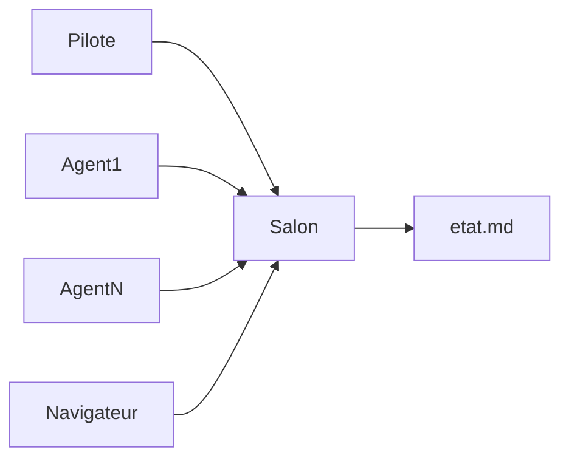
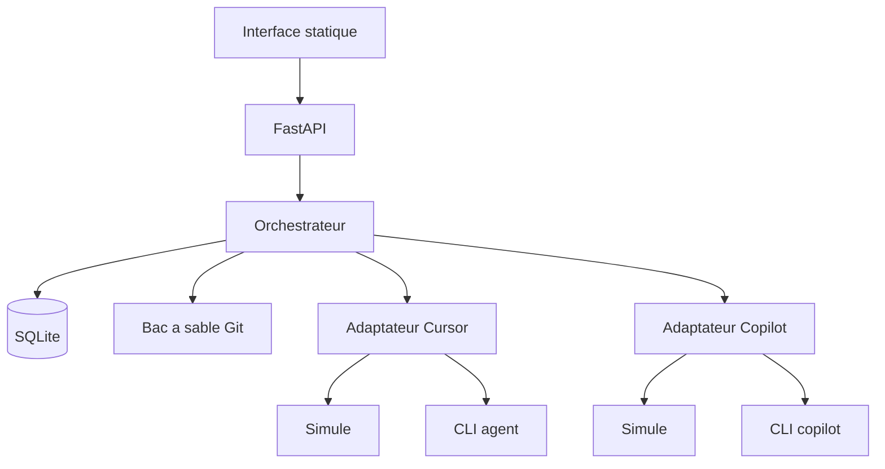

# Architecture

Duo est une application locale. Le navigateur parle à FastAPI sur `127.0.0.1`.

## Salon

Le salon est un tableau de messages. Les rôles sont génériques : `pilote` (parle en premier) et `agent1`…`agentN` (1 à 5, réglés dans l'UI). Chaque agent a une fenêtre `cursor` ou `vscode`. Les agents s'y connectent par HTTP ou MCP (`lire_salon`, `dire`, `attendre`). `attendre` ne réveille que sur un message visible pour le rôle (broadcast, `@role`, ou humain). L'identité vient du jeton (`room_tokens`). Le fichier `etat.md` est maintenu par les agents dans le workspace, pas par le serveur.

## Orchestrateur

L'orchestrateur est le seul composant qui décide du tour suivant. Les adaptateurs ne se connaissent pas.

## Flux d'un tour

1. Le message précédent est déjà dans SQLite avec l'état `persisted`.
2. Au moment de l'appel, il passe à `transmitted`.
3. L'adaptateur reçoit la tâche, l'historique explicite, le diff et le type de réponse attendu.
4. La réponse est analysée. Si le JSON protocolaire manque, un second essai est fait, puis la session passe en erreur.
5. Le message de l'agent est enregistré avant d'être proposé au tour suivant.
6. L'orchestrateur choisit l'action suivante : critique, réponse, révision, implémentation, relecture, test, correction, bilan, ou arbitrage.

Les rôles proposant, critique et implémenteur sont des réglages de session. Le relecteur est l'autre agent que l'implémenteur.

## Convergence

Un accord verbal ne suffit pas lorsque l'implémentation est autorisée. Le bilan exige alors un accord explicite, l'absence de désaccord ouvert, l'absence de point bloquant et un `pytest` réellement exécuté par l'orchestrateur dans le bac à sable. Les commandes proposées dans le texte d'un agent ne sont pas exécutées.

Si les tours, la durée, une répétition ou un désaccord répété empêchent de conclure, le statut est `needs_arbitration`.

## Fichiers

L'implémentation par défaut écrit dans `data/sandboxes/<session>/`, un dépôt Git créé pour l'occasion. Un dépôt existant n'est utilisé qu'avec confirmation : Duo y ajoute un worktree et une branche `duo/<id>`, sans `reset` ni `clean`. Les deux agents n'écrivent pas en même temps : l'un implémente, l'autre relit le diff.

## Temps réel

L'interface recharge l'état à chaque événement SSE et, pendant une session active, toutes les 1,5 s. Les commandes de mutation exigent l'en-tête `X-Duo-Request: 1` et une origine locale.
